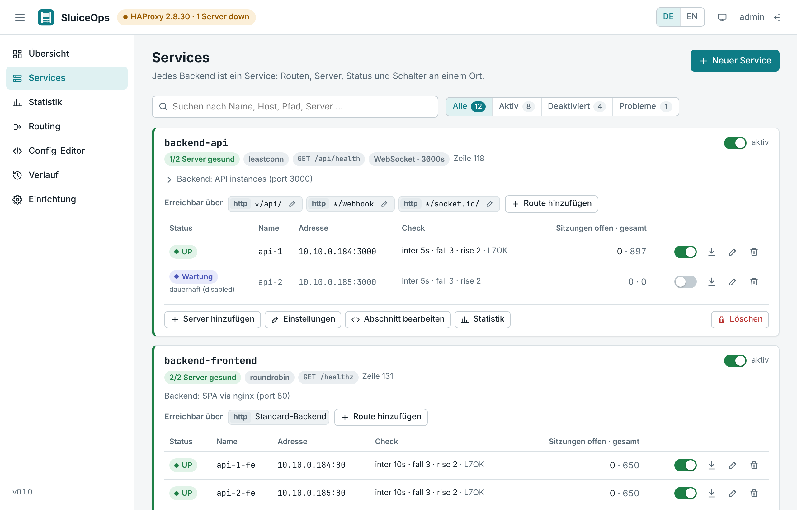
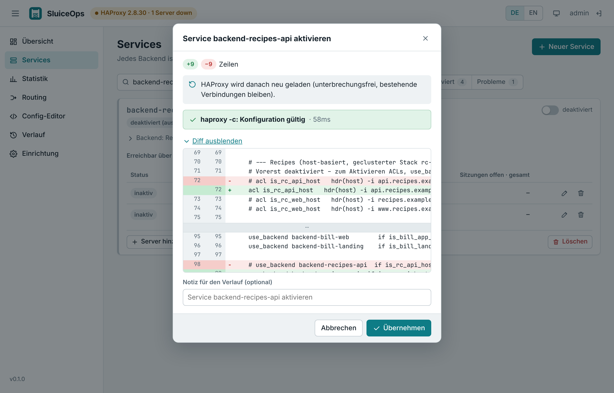
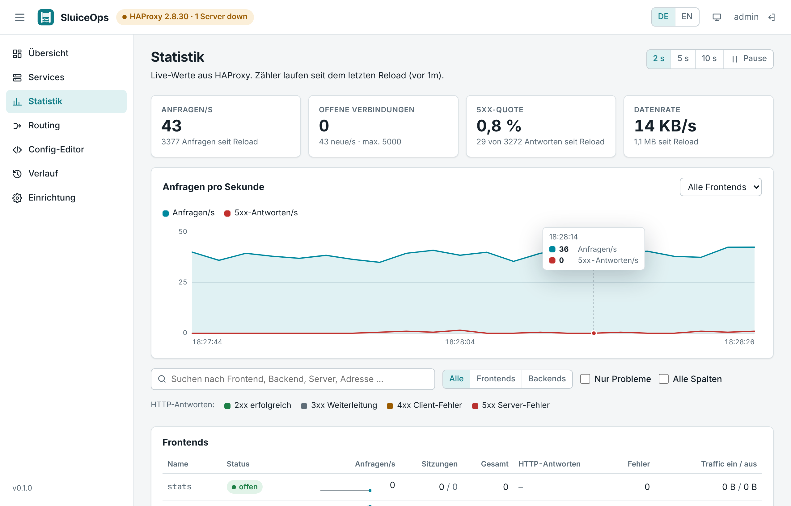
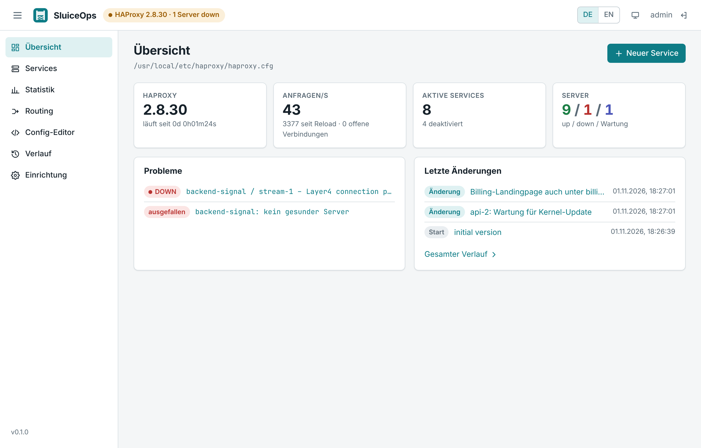
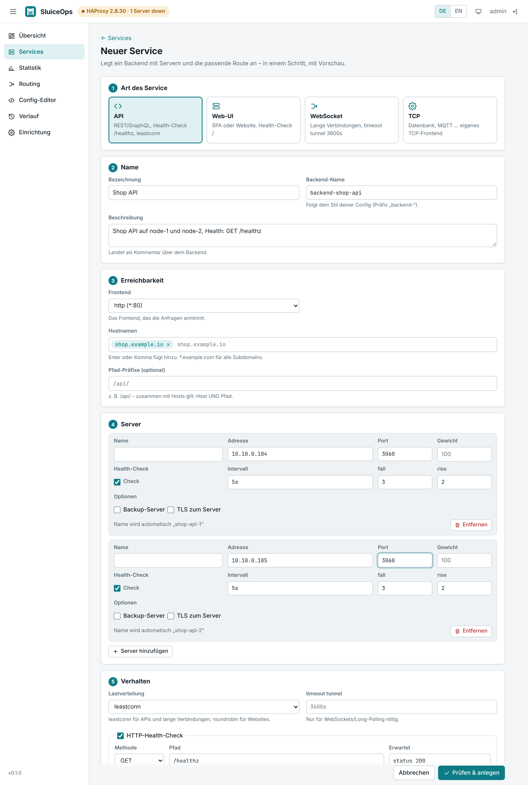

<p align="center">
  
</p>

<h1 align="center">SluiceOps</h1>

<p align="center">
  Eine Web-Oberfläche für HAProxy, die deine <code>haproxy.cfg</code> genau so lässt, wie du sie geschrieben hast.<br/>
  <a href="README.md">English version</a>
</p>

---

<p align="center"></p>

Mit SluiceOps fügst du Services hinzu, schaltest Routen und Server ein und aus, siehst den Live-Status und bearbeitest die Konfiguration eines bestehenden HAProxy im Browser. SluiceOps ist freie Software (AGPL-3.0), ohne Bezahlstufe und ohne gesperrte Funktionen.

> [!WARNING]
> **Frühe Version (0.x).** SluiceOps ist neu und bisher nur mit wenigen Setups getestet. Bevor du damit ein produktives HAProxy verwaltest:
>
> - probiere es zuerst mit einer Kopie deiner Konfiguration aus oder starte es mit `-read-only` und sieh dich um,
> - prüfe vor jeder Änderung den Diff im Prüf-Dialog,
> - behalte eine eigene Sicherung deiner `haproxy.cfg` (SluiceOps führt zwar einen Verlauf, verlass dich aber nicht allein darauf).
>
> Fehlerberichte und Rückmeldungen sind sehr willkommen – bitte [ein Issue anlegen](https://github.com/toolvibes/sluiceops/issues).

## Warum noch eine HAProxy-UI?

Die meisten Tools lesen die `haproxy.cfg` in ein Datenmodell ein und schreiben eine neu erzeugte Datei zurück. Kommentare wandern an den Anfang ihres Abschnitts oder verschwinden, Abschnitte werden umsortiert, aus `inter 5s` wird `inter 5000`. Für eine von Hand gepflegte und dokumentierte Config ist das nicht akzeptabel.

SluiceOps arbeitet anders:

- **Zeilengenauer Editor.** Jede Änderung fasst nur die Zeilen an, um die es geht. Kommentare, Leerzeilen, Ausrichtung und Reihenfolge bleiben Byte für Byte erhalten. Deaktivierst du etwas und aktivierst es wieder, ist die Datei identisch zum Original.
- **Deine Config bleibt die maßgebliche Quelle.** Keine Datenbank, kein Import. SluiceOps auf eine vorhandene `haproxy.cfg` zeigen lassen, fertig. Du kannst die Datei weiterhin von Hand bearbeiten; SluiceOps erkennt solche Änderungen und nimmt sie in den Verlauf auf. Ohne SluiceOps bleibt eine ganz normale HAProxy-Config zurück.
- **„Deaktiviert“ heißt auskommentiert**, so wie man es von Hand macht. SluiceOps erkennt auskommentierte `use_backend`-Regeln, ACLs, Server und ganze `backend`-Blöcke als deaktivierte Konfiguration. Das Aktivieren eines vorbereiteten Services kommentiert ACLs, Regel und Backend-Block in einem Schritt ein.
- **Jede Änderung wird geprüft.** Du siehst zuerst den Diff, `haproxy -c` prüft das Ergebnis, erst dann wird geschrieben und HAProxy unterbrechungsfrei neu geladen. Jede Version bleibt erhalten und kann wiederhergestellt werden.
- **Live, wo es geht.** Wartung und Drain für Server laufen über die Runtime-API ohne Reload und werden zusätzlich in der Datei gespeichert (`disabled`). Damit übersteht der Zustand auch den nächsten Reload.

## Funktionen

- Service-Übersicht: jedes Backend mit den Hosts und Pfaden, die dorthin führen, Server mit Live-Healthcheck, Schalter zum Aktivieren und Deaktivieren
- Assistent für neue Services (Vorlagen für API, Web-UI, WebSocket, TCP): Backend, Server, Healthcheck und Host/Pfad-Route in einer Änderung
- Routing-Ansicht je Frontend in exakter Regel-Reihenfolge (erste passende Regel gewinnt): Routen anlegen, bearbeiten, deaktivieren, löschen, Default-Backend
- Live-Statistik je Frontend, Backend und Server: Anfragen/s mit Verlauf, Sitzungen, HTTP-Antwortklassen, Fehler, Antwortzeiten, Traffic
- Server-Verwaltung: hinzufügen, bearbeiten, Wartung, Drain, löschen
- Backend-Einstellungen: Modus, Balancing, Healthcheck, Timeouts; einzelne Abschnitte als Text bearbeiten
- Vollständiger Config-Editor mit Validierung und Markierung der Fehlerzeilen
- Verlauf aller Versionen (auch Änderungen außerhalb von SluiceOps), Diffs, Rollback per Klick
- Einrichtungsprüfung (Schreibrechte, Validator, Runtime-Socket, Reload, Versionsabgleich)
- Oberfläche auf Deutsch und Englisch, helles und dunkles Design
- Ein einzelnes Binary oder Docker-Image, keine Datenbank

## Screenshots

**Prüfung vor jeder Änderung – hier: Aktivieren eines vorbereiteten, auskommentierten Services**



**Live-Statistik**

<picture>
  <source media="(prefers-color-scheme: dark)" srcset="docs/screenshots/de/statistics-dark.png" />
  
</picture>

**Übersicht**



<details>
<summary><b>Assistent für neue Services</b></summary>


</details>

## Schnellstart mit Docker Compose

Angenommen, deine Config liegt unter `./haproxy/haproxy.cfg`:

```yaml
services:
  haproxy:
    image: haproxy:2.9-alpine
    command: ["haproxy", "-W", "-db", "-f", "/usr/local/etc/haproxy/haproxy.cfg", "-S", "/var/lib/haproxy/master.sock"]
    volumes:
      - ./haproxy:/usr/local/etc/haproxy        # Verzeichnis, nicht die einzelne Datei
      - haproxy-run:/var/lib/haproxy             # gemeinsamer Master-Socket
    ports: ["80:80"]

  sluiceops:
    image: ghcr.io/toolvibes/sluiceops:haproxy2.9 # gleiche HAProxy-Version wie oben
    environment:
      SLUICEOPS_MASTER_SOCKET: /var/lib/haproxy/master.sock
      SLUICEOPS_ADMIN_PASSWORD: bitte-aendern
    volumes:
      - ./haproxy:/usr/local/etc/haproxy
      - haproxy-run:/var/lib/haproxy
      - sluiceops-data:/var/lib/sluiceops
    ports: ["127.0.0.1:8484:8484"]

volumes:
  haproxy-run:
  sluiceops-data:
```

Beide Container laufen als UID 99 (Benutzer `haproxy` des offiziellen Images). Gib ihm einmalig Schreibrechte auf das Config-Verzeichnis:

```bash
sudo chown -R 99:99 ./haproxy
```

Danach http://127.0.0.1:8484 öffnen und als `admin` anmelden. Ein vollständiges, kommentiertes Beispiel liegt in [`deploy/docker-compose.example.yml`](deploy/docker-compose.example.yml).

Du hast schon ein laufendes HAProxy-Compose-Setup? Die Anleitung [Umstieg mit Docker](docs/umstieg-docker.md) zeigt Schritt für Schritt, was sich ändert.

**Warum diese Änderungen an einer typischen HAProxy-Compose-Datei?**

| Änderung | Grund |
|---|---|
| Verzeichnis statt Datei mounten | Einzelne Datei-Mounts zeigen nach dem Ersetzen einer Datei weiter die alte Version. SluiceOps schreibt zwar direkt in die Datei, aber ein Verzeichnis-Mount funktioniert mit jedem Editor. |
| `-S /var/lib/haproxy/master.sock` | Über den Master-Socket kommen Live-Status, Wartung und Drain ohne Reload sowie unterbrechungsfreie Reloads. Niemand braucht Zugriff auf den Docker-Socket. |
| Gleiche HAProxy-Version in beiden Images | Die Validierung läuft mit `haproxy -c` im SluiceOps-Container. Images gibt es pro HAProxy-Version: `haproxy2.8`, `haproxy2.9`, `haproxy3.0`, `haproxy3.2`. |

## Binary direkt starten

```bash
sluiceops \
  -config /etc/haproxy/haproxy.cfg \
  -master-socket /run/haproxy/master.sock \
  -data-dir /var/lib/sluiceops
```

Ohne Master-Socket geht es auch mit einem Stats-Socket (`stats socket /run/haproxy/admin.sock mode 660 level admin` im `global`-Abschnitt) und einem Reload-Befehl:

```bash
sluiceops -config /etc/haproxy/haproxy.cfg \
  -stats-socket /run/haproxy/admin.sock \
  -reload-cmd "systemctl reload haproxy"
```

Alle Optionen mit den passenden Umgebungsvariablen findest du in der [englischen README](README.md#options).

## So wird eine Änderung übernommen

1. Die aktuelle Datei wird gelesen und ihre Version (Inhalts-Hash) mit der im Browser verglichen. Hat jemand die Datei inzwischen geändert, bekommst du einen Konflikt, statt seine Arbeit zu überschreiben.
2. Die Änderungen werden zeilengenau auf eine Kopie angewendet.
3. Du siehst den Diff, `haproxy -c` prüft das komplette Ergebnis.
4. Die Datei wird geschrieben, die vorherige Version liegt im Verlauf.
5. HAProxy wird über den Master-Socket unterbrechungsfrei neu geladen. Bei Wartung und Drain von Servern greift die Änderung stattdessen live über die Runtime-API, ganz ohne Reload.

## Sicherheit

Wer SluiceOps bedienen kann, steuert den gesamten Verkehr deines HAProxy. Betreibe es im internen Netz oder hinter deinem Reverse Proxy mit zusätzlicher Zugriffskontrolle, nicht offen im Internet. Sitzungen nutzen `HttpOnly`/`SameSite=Strict`-Cookies, ändernde Anfragen brauchen einen eigenen Header (CSRF-Schutz), fehlgeschlagene Logins werden gebremst. Sicherheitslücken bitte wie in [SECURITY.md](SECURITY.md) beschrieben melden.

## Grenzen

- Die Formulare decken die häufigen Fälle ab (Services, Server, Host/Pfad-Routing, Healthchecks, Timeouts). Alles andere bleibt unangetastet und lässt sich im Abschnitts- oder Config-Editor bearbeiten.
- Routen mit komplexen Bedingungen (`||`, Negationen, andere Fetches) werden angezeigt und lassen sich ein- und ausschalten, müssen aber als Text bearbeitet werden.
- Eine HAProxy-Instanz pro SluiceOps-Instanz. Auf mehrere Dateien verteilte Configs (`-f dir/`) werden noch nicht unterstützt.

## Mitmachen

Beiträge sind willkommen, siehe [CONTRIBUTING.md](CONTRIBUTING.md).

## Lizenz

SluiceOps steht unter der [GNU Affero General Public License v3.0](LICENSE). Du darfst es nutzen, verändern und weitergeben. Wer eine veränderte Version anderen über ein Netzwerk anbietet, muss ihnen auch den Quellcode zur Verfügung stellen.

HAProxy ist eine Marke der HAProxy Technologies LLC. SluiceOps ist ein unabhängiges Projekt und steht in keiner Verbindung zu HAProxy Technologies.
